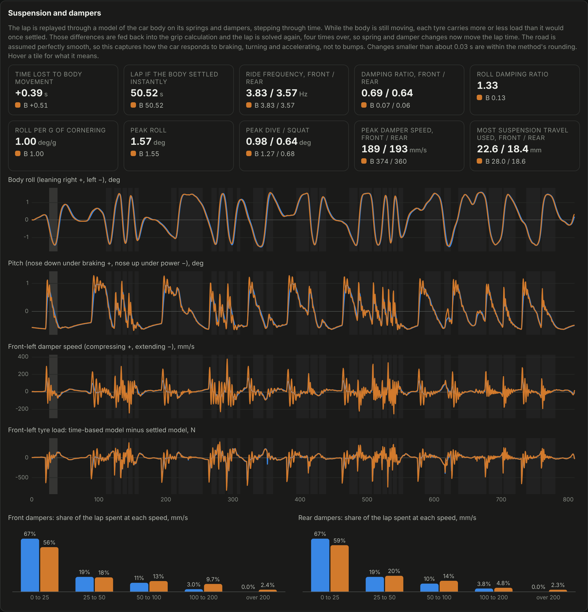

# FS Lap Sim

An interactive lap time simulator for **electric Formula Student cars**. Enter the car's figures, pick an event, and see lap time, energy use and what the car is doing at every corner. Two setups can be compared side by side.




## What it does

- **Events:** 75 m acceleration, skidpad, an FS UK sprint lap, the 22 km FS UK endurance (with battery energy tracked lap by lap), and flying laps of the Silverstone and Hockenheim Grand Prix circuits.
- **Car inputs:** mass, wheelbase, track widths, centre of gravity, tyre grip and load sensitivity, downforce and drag, motor torque/power/speed, gear ratio, driven wheels, battery capacity/voltage/resistance/current limit, regen, brake bias, spring rates, anti-roll bars and damper rates. The defaults are a typical mid-field electric FS car, not a specific team's car.
- **Conditions:** driver accuracy, battery charge, power limit, tyre wear, track grip (dry to wet) and air temperature.
- **Per-corner view:** click a corner on the map for entry, minimum and exit speed, cornering and braking g, tyre loads, grip used on each axle, body roll, motor torque and battery power, for setup A and B.

## How it works

The physics is a *quasi-steady-state* simulation written in plain Python (`fslap/`). The track is cut into short steps. The solver:

1. finds the highest speed the car can hold through each bend (tyre grip, including downforce and load transfer, against the cornering force needed);
2. drives forward from each slow point, accelerating as hard as the tyres, motor and power limit allow;
3. works backward from each corner to find where braking has to start.

The lowest of those speeds at each point is the fastest possible lap for a perfect driver. The same Python runs in the browser through [Pyodide](https://pyodide.org), so the site needs no server.

| File | What it holds |
| --- | --- |
| `fslap/params.py` | Every input, its unit, default and explanation |
| `fslap/vehicle.py` | Car model: tyres, aero, load transfer, motor, battery, brakes |
| `fslap/ride.py` | Time-based spring and damper replay: roll, pitch, heave, damper speeds |
| `fslap/solver.py` | The lap solver, energy accounting and corner detection |
| `tools/build_tracks.py` | Builds `data/tracks.json` from rulebook dimensions, open racing lines and GPS |
| `web/` and `index.html` | The page: track map, charts and tables |
| `tests/` | Benchmark and sanity checks |

## Assumptions

Fixed driving line. Driver accuracy is the share of tyre grip the driver uses (100% = perfect), applied evenly round the lap; mistakes and early lifting are not modelled. Flat track. Springs and dampers act on lap time through tyre load: the lap is solved, replayed through time on its springs and dampers (`fslap/ride.py`), and solved again with the tyre loads from that replay, four times over. Differences under about 0.03 s are within this method's rounding. All load transfer is assumed to pass through springs and dampers. In that replay dampers are linear, tyres are rigid vertically, the road is smooth, inputs build with a 0.08 s lag, and roll and pitch inertia use assumed radii of gyration (0.30 m and 0.60 m). Roll centres at ground level. Tyres are a peak grip coefficient with linear load sensitivity and a friction ellipse for combined cornering and braking; no tyre temperature, camber or toe. Tyre wear is a linear grip loss up to 12% when fully worn. All-wheel drive splits torque in proportion to axle grip. Regen keeps the set brake balance and is off below 5 km/h. Battery limits are held constant within a lap and updated between laps. The endurance driver change is not timed.

## Validation so far

| Check | Simulator (default car) | Reference |
| --- | --- | --- |
| 75 m acceleration | 4.08 s | about 3.3 s (best AWD) to 4.5 s for competitive electric FS cars |
| Skidpad | 4.97 s | about 4.7 to 5.3 s |
| Skidpad, no wings, constant grip | within 0.06 s | textbook v = sqrt(mu g R) |
| Spring and damper replay, settled values | identical tyre loads and roll angle | the steady model |
| Spring and damper replay, overshoot after a sudden input | within 2% | textbook exp(-pi z / sqrt(1 - z^2)) |
| Damper feedback into lap time | settles within 0.06 s between rounds; steady skidpad unchanged by dampers; a badly underdamped car is slower | expected behaviour |
| FS UK endurance lap against a logged stint | speed trace correlation 0.96, lap about 19% quicker | logged GPS laps |

The last row matters: the shape of the lap is right, but a generic car with a perfect driver is quicker than a real driver in a real car. Absolute lap times should not be quoted as accurate until the inputs are a real car's figures.

## Running it

Open the hosted page, or locally:

```
python3 -m http.server 8000      # then visit http://localhost:8000
python3 -m unittest discover tests
```

## Credits

Grand Prix racing lines: [TUM racetrack database](https://github.com/TUMFTM/racetrack-database) (LGPL-3.0). Python in the browser: Pyodide (MPL-2.0). Structure ideas (separate vehicle data, event library, per-event results) were inspired by MathWorks' [Formula Student Vehicle Simscape](https://github.com/simscape/Formula-Student-Vehicle-Simscape) project; no code or data was copied from it.
