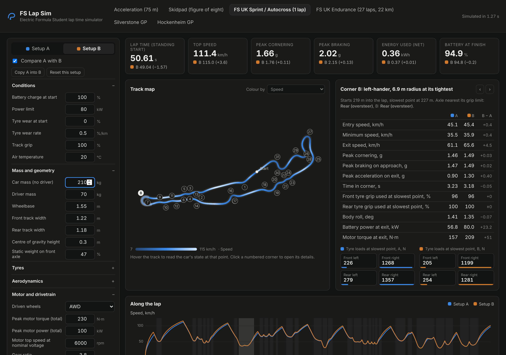
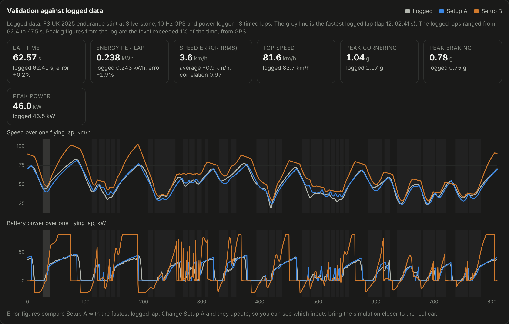
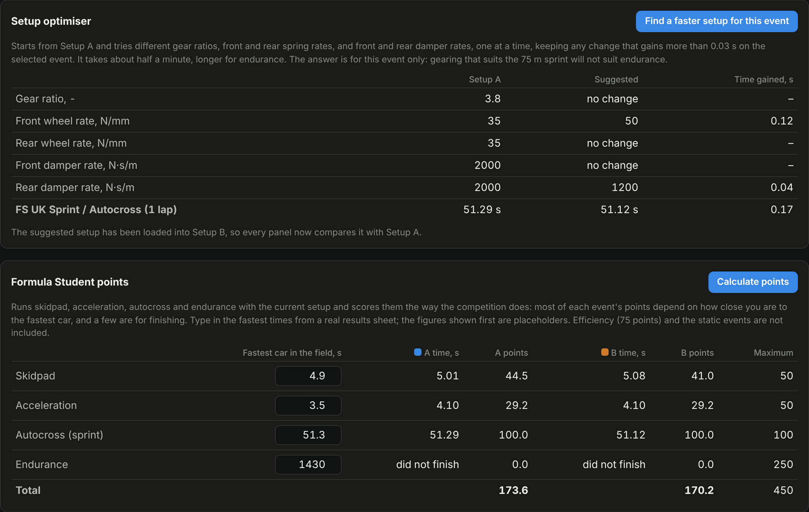
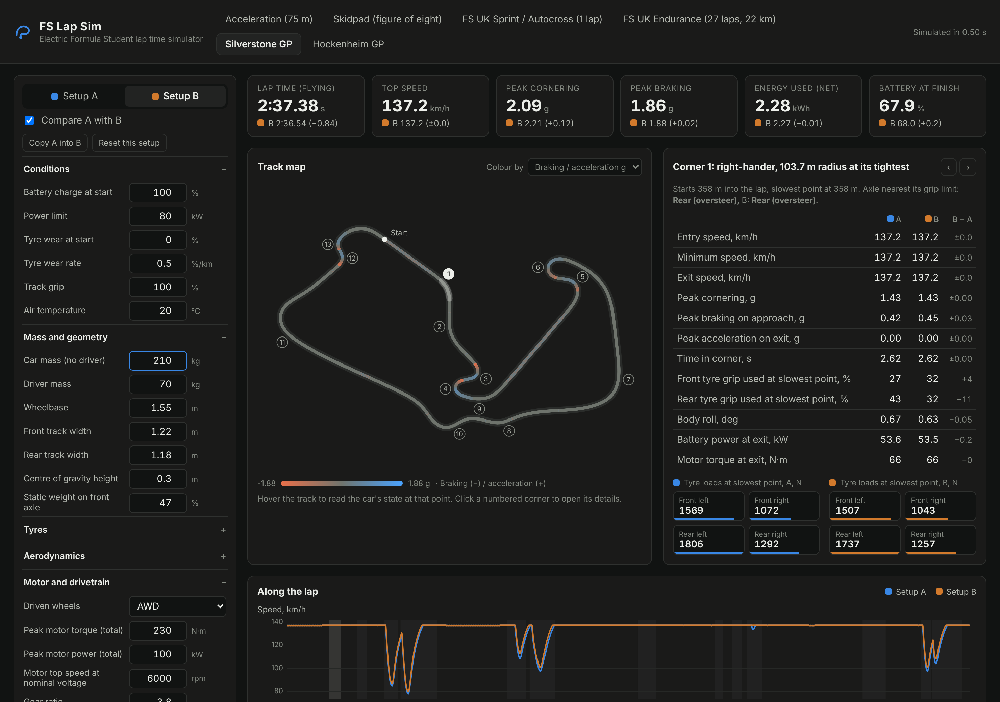

# FS Lap Sim

An interactive lap time simulator for **electric Formula Student cars**. Enter the car's figures, pick an event, and see lap time, energy use and what the car is doing at every corner. Two setups can be compared side by side.

**Live demo:** https://divijdhingra.github.io/fs-lap-sim/



| | |
| --- | --- |
|  |  |
|  |  |

## What it does

- **Events:** 75 m acceleration, skidpad, an FS UK sprint lap, the 22 km FS UK endurance (with battery energy tracked lap by lap), and flying laps of the Silverstone and Hockenheim Grand Prix circuits.
- **Car inputs:** mass, wheelbase, track widths, centre of gravity, tyre grip, load sensitivity and slip at peak grip (Pacejka Magic Formula curves), downforce and drag, motor torque/power/speed, gear ratio, driven wheels, differential or torque vectoring, cooling, battery capacity/voltage/resistance/current limit, regen, brake bias, spring rates, anti-roll bars and damper rates. The defaults are a typical mid-field electric FS car, not a specific team's car.
- **Conditions:** driver model (cornering, braking and traction grip used, lift and coast, traction control), track roughness, battery charge, power limit, tyre temperature and wear, battery and motor temperature, track grip (dry to wet) and air temperature.
- **Suspension and dampers:** a time-based replay of body roll, pitch and heave, road bumps, damper speed histograms, and their effect on lap time.
- **Setup optimiser:** searches gear ratio, spring rates and damper rates for the selected event and loads the result into Setup B.
- **Real competition cone layouts:** six past competition courses (FSG 2018, 2019 and 2023, FS Italy 2018, FS Spain 2019, FS East 2022, all driverless-class courses) rebuilt from their cone positions, each runnable as a single lap or a 22 km endurance.
- **Track builder:** draw your own cone layout by placing points; the page lays out the cones, checks the layout against the rules' hairpin size, and the simulator finds the line a driver would take inside the cones.
- **Grip envelope (g-g-v diagram):** the limit of combined cornering, braking and acceleration at five speeds, with every step of the simulated lap plotted on it.
- **Sensitivity sweep:** step any one figure (mass, downforce, drag, power, grip, centre of gravity height and so on) across a range and plot lap time and energy against it.
- **Points calculator:** runs the four dynamic events and scores them with the Formula Student formulas.
- **Validation:** compares the simulation with a logged FS UK endurance lap, with error figures that update as you change the car.
- **Saving setups:** name a setup and save it in the browser, or export it to a small JSON file and import it again later or on another computer.
- **Per-corner view:** click a corner on the map for entry, minimum and exit speed, cornering and braking g, tyre loads, grip used on each axle, tyre slip angles, steering angle, tyre camber, body roll, motor torque and battery power, for setup A and B.

## How it works

The physics is a *quasi-steady-state* simulation written in plain Python (`fslap/`). The track is cut into short steps. The solver:

1. finds the highest speed the car can hold through each bend (tyre grip, including downforce and load transfer, against the cornering force needed);
2. drives forward from each slow point, accelerating as hard as the tyres, motor and power limit allow;
3. works backward from each corner to find where braking has to start.

The lowest of those speeds at each point is the fastest possible lap for a perfect driver. The same Python runs in the browser through [Pyodide](https://pyodide.org), so the site needs no server.

| File | What it holds |
| --- | --- |
| `fslap/params.py` | Every input, its unit, default and explanation |
| `fslap/tyre.py` | Pacejka Magic Formula tyre curves (slip angle, wheel slip, cornering drag), tyre temperature and wear |
| `fslap/thermal.py` | Battery and motor heating, and the power cut-back when hot |
| `fslap/vehicle.py` | Car model: tyres, aero, load transfer, motor, battery, brakes |
| `fslap/ride.py` | Time-based spring and damper replay: roll, pitch, heave, damper speeds |
| `fslap/bumps.py` | Road bumps: quarter-car model and ISO 8608 road roughness |
| `fslap/solver.py` | The lap solver, energy accounting and corner detection |
| `tools/build_validation.py` | Builds `data/validation.json` from logged data |
| `tools/build_tracks.py` | Builds `data/tracks.json` from rulebook dimensions, open racing lines, GPS and cone positions |
| `fslap/layout.py` | Turns a coned lane into the line the car drives |
| `web/builder.js` | The draw-your-own layout editor |
| `web/` and `index.html` | The page: track map, charts and tables |
| `tests/` | Benchmark and sanity checks |

## Assumptions

Fixed driving line. Suspension geometry is entered as roll centre heights, anti-dive, anti-squat and camber rather than arm positions, and the camber and temperature grip curves are assumed placeholders, not fitted tyre data. The driver uses a set share of tyre grip in corners, under braking and on corner exit (100% = perfect), applied evenly round the lap, and can lift and coast a set distance before each braking point; mistakes and lap to lap variation are not modelled. Flat track. Springs and dampers act on lap time through tyre load: the lap is solved, replayed through time on its springs and dampers (`fslap/ride.py`), and solved again with the tyre loads from that replay, four times over. Differences under about 0.03 s are within this method's rounding. All load transfer is assumed to pass through springs and dampers. Road bumps use a quarter-car model per corner and the ISO 8608 roughness scale to get tyre load flutter; the grip lost is an assumed share of that flutter (0.3 by default) pending tyre test data. In the body replay dampers are linear, kerbs are not modelled, inputs build with a 0.08 s lag, and roll and pitch inertia use assumed radii of gyration (0.30 m and 0.60 m). Roll centres at ground level. Tyres are a peak grip coefficient with linear load sensitivity and a friction ellipse for combined cornering and braking; no tyre temperature, camber or toe. Tyre wear is a linear grip loss up to 12% when fully worn. All-wheel drive splits torque in proportion to axle grip. Regen keeps the set brake balance and is off below 5 km/h. Battery limits are held constant within a lap and updated between laps. The endurance driver change is not timed.

## Validation so far

| Check | Simulator (default car) | Reference |
| --- | --- | --- |
| 75 m acceleration | 4.12 s | about 3.3 s (best AWD) to 4.5 s for competitive electric FS cars |
| Skidpad | 5.14 s | about 4.7 to 5.3 s |
| Skidpad, no wings, constant grip | within 0.06 s | textbook v = sqrt(mu g R) |
| Spring and damper replay, settled values | identical tyre loads and roll angle | the steady model |
| Spring and damper replay, overshoot after a sudden input | within 2% | textbook exp(-pi z / sqrt(1 - z^2)) |
| Damper feedback into lap time | settles within 0.06 s between rounds; steady skidpad unchanged by dampers; a badly underdamped car is slower | expected behaviour |
| Bump model gain | within 3% of a step-by-step simulation; exact mass x acceleration limit at low frequency | independent time-stepping, hand calculation |
| Best damper setting over bumps | damping ratio about 0.4 | textbook road-holding optimum of roughly 0.3 to 0.5 |
| FS UK flying lap, preset fitted to a logged stint | lap time +0.4%, energy per lap -1.8%, peak braking 0.78 g against 0.75 g (all fitted); speed trace 3.6 km/h RMS, correlation 0.97 (not fitted) | logged GPS and power, fastest of 13 laps |
| FS UK flying lap, default car and perfect driver | about 19% quicker than the log | same |

The default car is generic, so its absolute lap times are not a prediction for any real car. The fitted preset shows the model can reproduce a real lap once the inputs are right, with one known weakness: the simulated driver's peak cornering is 1.04 g against 1.17 g logged, because the real driver reaches the limit in only a few corners while the simulated driver uses the same share of grip in every corner. The validation panel on the FS UK Endurance tab shows all of this live.

## Running it

Open the hosted page, or locally:

```
python3 -m http.server 8000      # then visit http://localhost:8000
python3 -m unittest discover tests
```

## Credits

Grand Prix racing lines: [TUM racetrack database](https://github.com/TUMFTM/racetrack-database) (LGPL-3.0). Competition cone layouts: [AMZ Racing FSSIM](https://github.com/AMZ-Racing/fssim) and [layout-merchant](https://github.com/papalotis/layout-merchant) (both MIT; see `data/raw/README.md`). Python in the browser: Pyodide (MPL-2.0). Structure ideas (separate vehicle data, event library, per-event results) were inspired by MathWorks' [Formula Student Vehicle Simscape](https://github.com/simscape/Formula-Student-Vehicle-Simscape) project; no code or data was copied from it.
