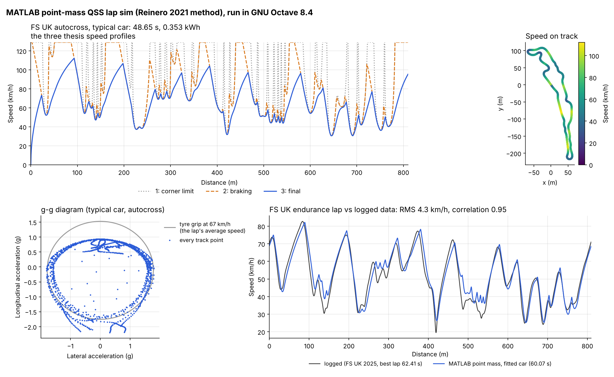

# MATLAB point-mass lap time simulator

A point-mass, quasi-steady-state (QSS) lap time simulator in plain MATLAB, following
chapter 4 of A. Reinero, *Lap time simulator for a single-seater electric car*
(MSc thesis, Politecnico di Torino, 2021). It uses the same car figures and tracks as the
website, so the two can be compared directly.



*Drawn from this code's output, run in GNU Octave 8.4 (a free MATLAB clone). Top: the
three thesis speed profiles on the FS UK autocross. Bottom right: one FS UK endurance lap
against Divij's logged data.*

## What you need

- MATLAB (any recent version, tested logic for R2026b). **No Simulink and no toolboxes.**
  Everything uses base MATLAB: `jsondecode`, `interp1`, `interp2`, plots.
- This repository cloned or downloaded. The code reads tracks from `../data/tracks.json`.

## How to run it

1. In MATLAB, set the current folder to `fs-lap-sim/matlab`.
2. Open `run_lap.m` and press **Run**. It simulates the typical car on the FS UK autocross
   and draws four plots.
3. Type `validate_qss` in the Command Window to run every check below (PASS/FAIL) and
   plot the fitted car against the logged lap.

Change the car by editing `fs_car_typical.m` (each line is commented, SI units), or in a
script:

```matlab
car = fs_car_typical();
car.m = 280;                          % kg
car.CzA = 4.0;                        % m^2 more downforce
res = qss_lapsim(car, load_fs_track('skidpad'), struct('verbose', true));
plot_lap(res, load_fs_track('skidpad'));
```

`load_fs_track()` with no input lists the tracks: `accel`, `skidpad`, `fsuk_autocross`,
`fsuk_endurance`, six FSG / FSI / FSS / FSE driverless layouts, `silverstone_gp`,
`hockenheim_gp`. For your own GPS or cone line, use `track_from_xy(x, y, closed)`.
For a full 22 km endurance (27 laps, charge carried lap to lap):
`e = qss_endurance(car, load_fs_track('fsuk_endurance'), [], true)`.

## How it works, in plain English

The car is a single dot with one mass (a **point mass**): no separate front and rear tyres.
The track is cut into short pieces (0.25 to 2 m). On each piece the car is assumed to be in
balance for its speed and acceleration (**quasi-steady-state**): nothing that takes time to
build up, like body roll or tyre heating, is modelled.

| Step | File | What it does |
|---|---|---|
| 1. g-g-V diagram | `qss_ggv.m` | How hard the tyres can accelerate, brake and corner at each speed. Grip is a **friction ellipse**: grip used for cornering is not available for braking. Downforce adds load, so grip grows with speed. **Load sensitivity**: each extra newton on a tyre adds a little less grip than the last. |
| 2. Profile 1 | `qss_corner_speed.m` | The fastest speed the car could hold if each bend went on forever (`V^2 / R = lateral grip`). |
| 3. Profile 2 | `qss_lapsim.m` (`brake_pass`) | Walk the track backwards and lower speeds so the car can always brake in time for the next bend, while still cornering. |
| 4. Profile 3 | `qss_lapsim.m` (`drive_pass`) | Walk forwards, accelerating as hard as the tyres, the motor (`qss_motor_torque`, `qss_power_control`) and the battery (`qss_battery`) allow. Battery voltage sags under load and falls as charge is used, which lowers top speed and power. The final speed is the lowest of the three profiles. |
| 5. Auxiliary | `qss_lapsim.m` | Lap time, energy, state of charge, and the thesis's check that the car never left its grip envelope. |

Closed tracks are run as a **flying lap** (the thesis's "two loops"): the start speed is the
speed the car crosses the line with at the end of the lap.

**Output** of `qss_lapsim`: a struct with arrays along the track (`s` distance, `v` speed,
`t` time, `ax`, `ay`, `P_elec`, `SOC`, `E_elec` energy, …) and totals (`time`, `lap_time`,
`energy_kWh`, …). This is the interface a later MATLAB-to-website link will use.

Terms: **ClA / CzA** downforce coefficient x frontal area (m²); **CdA / CxA** drag coefficient
x area; **m_eq** equivalent mass, the mass plus the extra "felt" mass of spinning wheels and
motor rotors when speeding up or slowing down; **flux weakening** the fall in motor torque
at high rpm; **SOC** state of charge, %.

## Assumptions (all of them)

From the thesis method:
- Point mass: no load transfer between tyres, no yaw balance; ideal brake balance.
- Quasi-steady-state: no transient roll, pitch, yaw, tyre heating or wear.
- Friction ellipse between longitudinal and lateral grip; linear load sensitivity, with
  grip never below 40 % of nominal.
- Drag and rolling resistance included; flat track (no gradient, no banking).
- Battery = open-circuit voltage + internal resistance, both looked up from SOC.
- Ideal driver unless the driver shares below are set below 1.

Where the code differs from the thesis, and why:
- The thesis samples the g-g-V and interpolates it with `scatteredInterpolant`. The ellipse
  has an exact formula, so it is evaluated directly (same result, no interpolation error).
- Fixed-step searches (corner speed, braking speed, power control) are done by bisection:
  same tests, tighter answers.
- Motor torque and efficiency: no maps are available for our car, so by default torque is
  flat to the power limit, top speed scales with battery voltage, and efficiency is constant.
  Real maps plug in through `car.torque_map` and `car.eff_map` (thesis eq. 30 and 32).
- Additions, each removable: driven-axle traction limit with longitudinal load transfer for
  2WD cars (`car.drive = 'AWD'` removes it), battery current limit (`car.I_max`), regen
  (`car.regen_P_max = 0`), driver grip shares (`car.drv_*`), multi-lap endurance.

Figures that are mine, not the website's (marked ASSUMED in `fs_car_typical.m`): wheel
inertia 0.08 kg·m² each, motor rotor inertia 0.02 kg·m², gearbox efficiency 97 %.

## Validation (run 27 Nov 2026 in GNU Octave 8.4)

MATLAB itself was not available to me; the identical `.m` files were run in Octave.

| Check | Result |
|---|---|
| Skidpad vs hand calculation `2πR/√(μgR)` (no aero) | ratio 1.000, PASS |
| Acceleration vs hand calculation `√(2L/μg)` (grip only) | ratio 1.000, PASS |
| Acceleration 75 m, typical car (FS range 3.6 to 4.6 s) | 4.19 s, PASS |
| Skidpad, typical car (winged FS range 4.7 to 5.4 s) | 4.76 s, PASS |
| Power never above 80 kW / never outside grip envelope | PASS / PASS |
| Endurance, 27 laps of FS UK: flat out at 80 kW the 6.5 kWh pack runs flat after 19 laps; capped at 25 kW it finishes (22.9 min, 5.2 kWh, 18 % left) | same as the website's check |

Against the website engine (same car):

| | MATLAB | Website | Difference |
|---|---|---|---|
| Acceleration | 4.194 s | 4.117 s | +1.9 % (spin inertia; 4.088 s without it) |
| Skidpad | 4.761 s | 5.142 s | -7.4 % |
| FS UK autocross | 48.65 s | 52.21 s | -6.8 % |
| Autocross energy | 0.353 kWh | 0.392 kWh | -9.8 % |

The point mass is faster in corners because it has no load transfer: a real car's loaded
outside tyres gain less grip than the inside tyres lose. That is the same direction and size
as the thesis found (5.7 % faster than the real car, 7 % faster than a transient simulator).

Against Divij's logged FS UK 2025 endurance lap (car fitted to that log, flying lap):

| | MATLAB | Logged |
|---|---|---|
| Lap time | 60.07 s (-3.8 %) | 62.41 s |
| Energy per lap | 0.234 kWh (-3.4 %) | 0.243 kWh |
| Speed trace | RMS error 4.3 km/h, correlation 0.95 | |
| Peak braking | 0.91 g | 0.75 g |

Lap time and energy depend on figures that were **fitted** to this log on the website (grip,
driver shares, efficiency), so they are not an independent prediction. Only the shape of the
speed trace was not fitted. Braking peaks higher than logged because a point mass ignores
brake balance and load transfer under braking.
